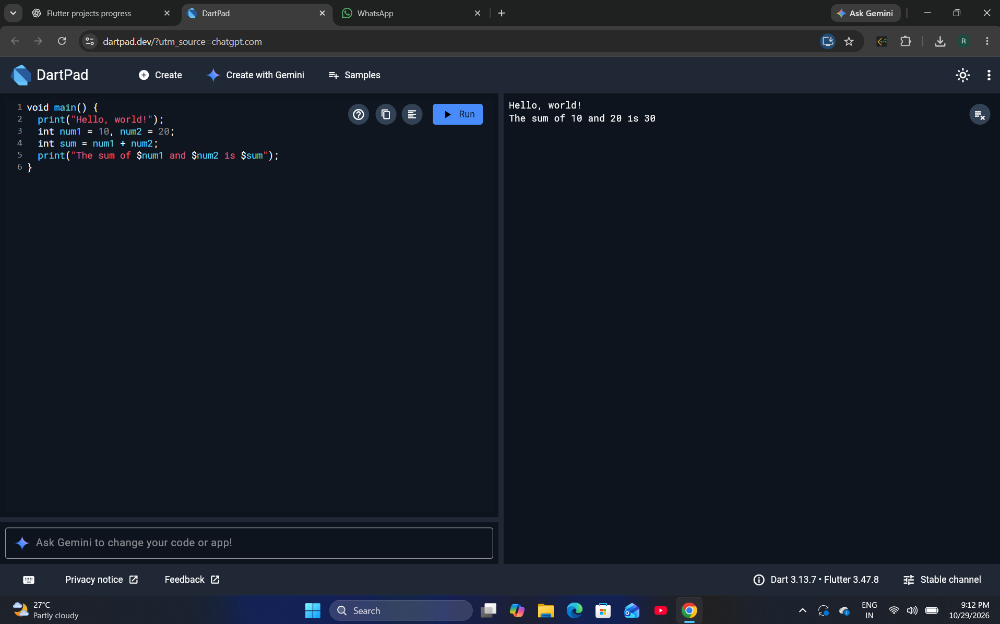
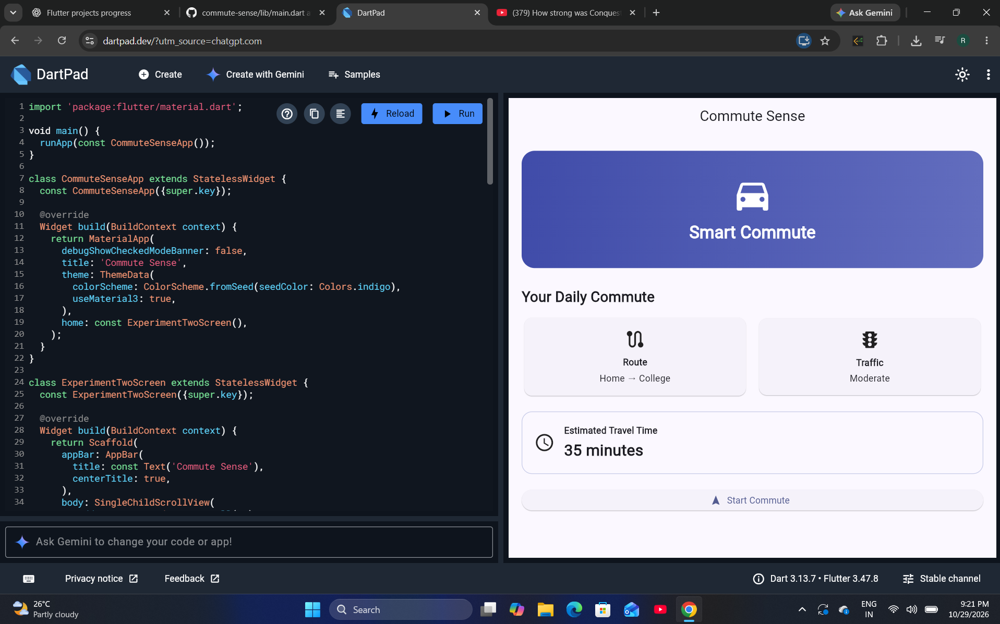
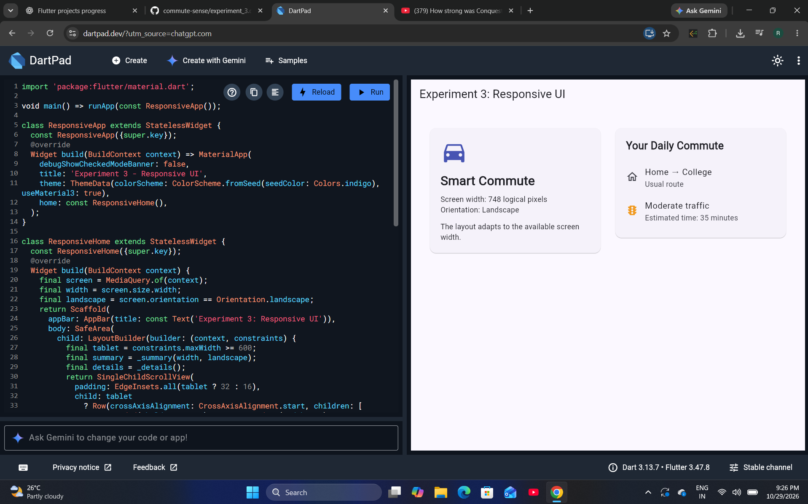
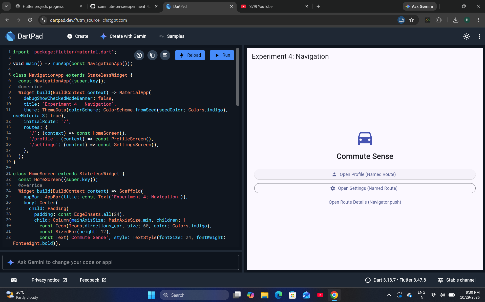
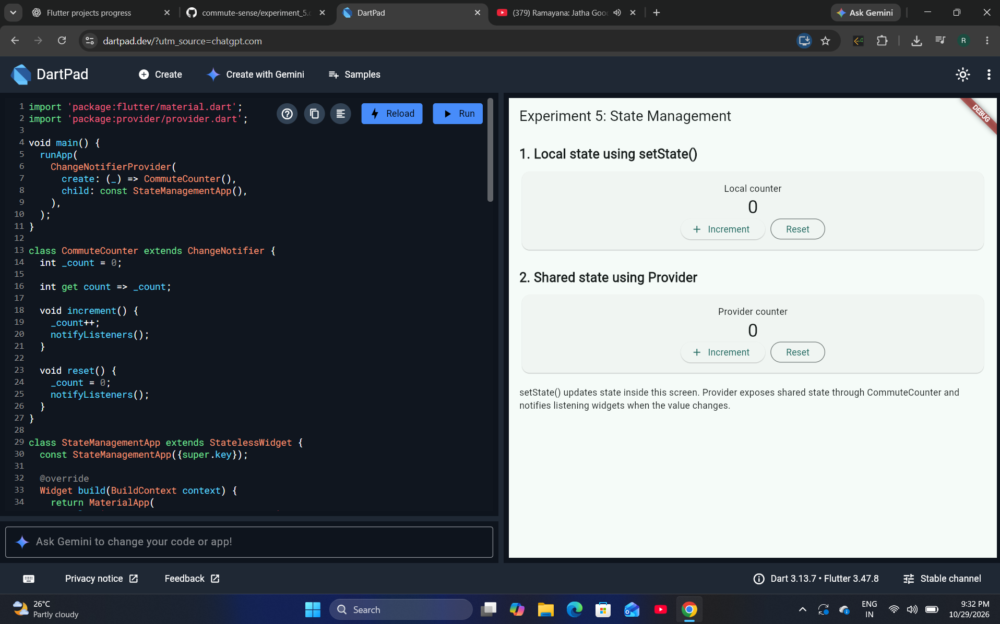
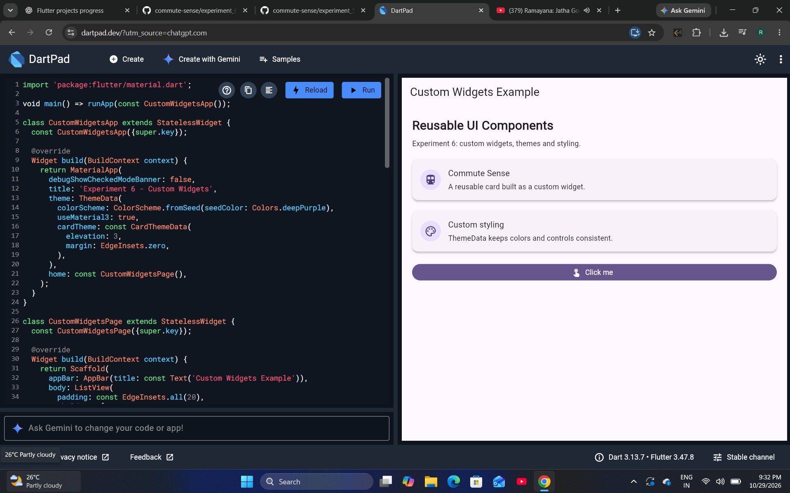
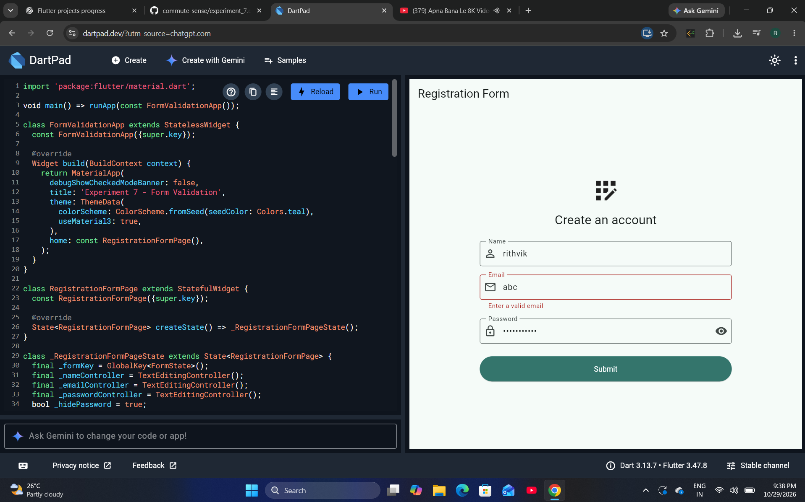
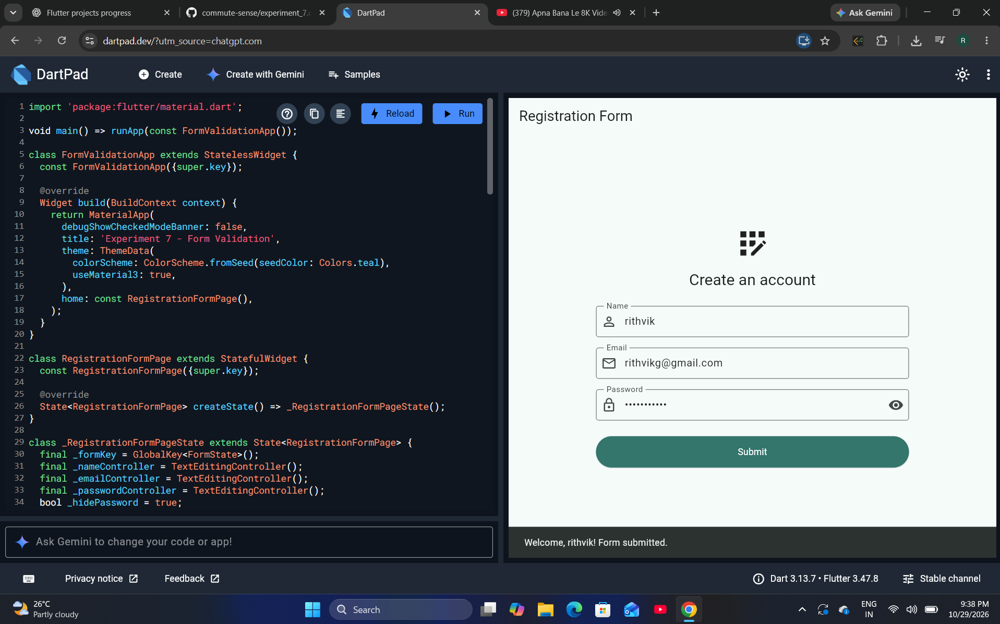
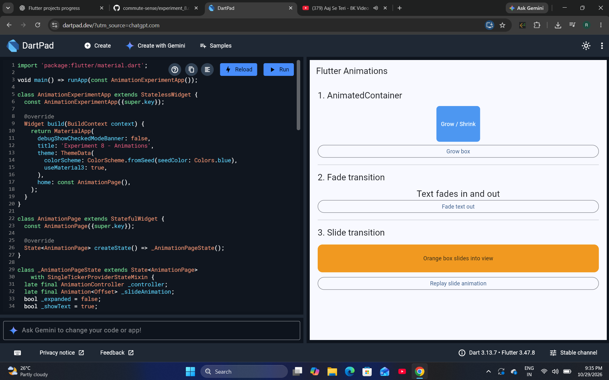
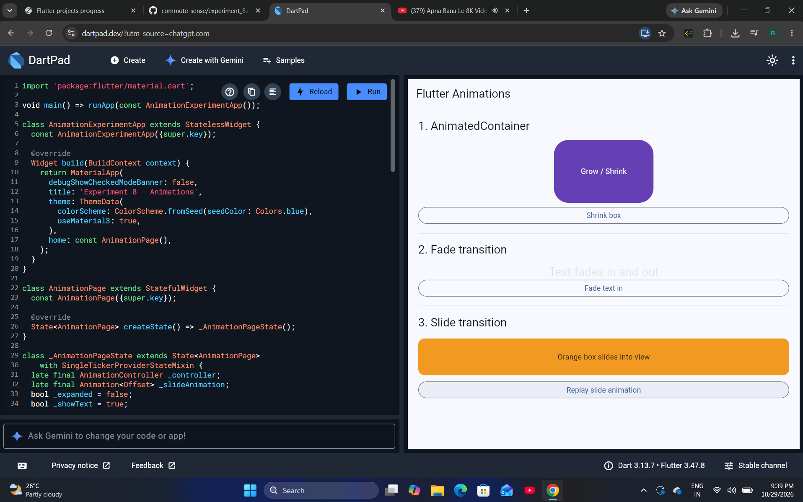

# Commute Sense — Flutter Lab Experiments

This repository contains eight standalone lab experiments. Each section includes the aim, an explanation of the main concept, the expected or observed output, and a screenshot of the experiment.

## Experiment 1 — Flutter and Dart Basics

**Aim:** Learn the Dart `main()` entry point, variables, arithmetic, string interpolation, and console output.

**Explanation:** The program prints a greeting, stores `10` and `20` in integer variables, adds them, and prints the result using string interpolation.

**Output:**

```text
Hello, world!
The sum of 10 and 20 is 30
```

**Output screenshot**



**Source code:** [experiment_1.dart](experiment_1.dart)

---

## Experiment 2 — Flutter Widgets and Layouts

**Aim:** Build a simple screen using common Flutter widgets and layout elements.

**Explanation:** This experiment demonstrates text widgets, icons, containers, cards, spacing, and basic styling. The Commute Sense dashboard displays a Smart Commute banner, Route and Traffic cards, estimated travel time, and a Start Commute button.

**Output screenshot**



**Source code:** [experiment_2.dart](experiment_2.dart)

---

## Experiment 3 — Responsive UI

**Aim:** Make a Flutter layout adapt to available screen dimensions.

**Explanation:** `MediaQuery` reads the screen dimensions and orientation. `LayoutBuilder` provides the available layout constraints, allowing the UI to arrange commute summary cards side-by-side when sufficient width is available.

**Observed output:** The preview reports a width of 748 logical pixels in landscape orientation and displays the Smart Commute and Your Daily Commute cards in a two-column layout.

**Output screenshot**



**Source code:** [experiment_3.dart](experiment_3.dart)

---

## Experiment 4 — Navigation

**Aim:** Navigate between screens using named routes and direct route pushes.

**Explanation:** `Navigator.pushNamed()` opens the Profile and Settings screens using registered route names. `Navigator.push()` with `MaterialPageRoute` opens Route Details directly. The app bar's back arrow returns to the previous screen.

**Observed output:** The Home screen displays buttons for Profile, Settings, and Route Details.

**Output screenshot**



**Source code:** [experiment_4.dart](experiment_4.dart)

---

## Experiment 5 — State Management

**Aim:** Compare local state using `setState()` with shared state using Provider.

**Explanation:** The first counter changes local widget state using `setState()`. The second uses a `ChangeNotifier` model. Calling `notifyListeners()` informs listening widgets that the state has changed and they may need to rebuild. Both counters provide Increment and Reset controls.

**Observed output:** Two independent counters are displayed: one using local state and the other using Provider-managed state.

**Output screenshot**



**Source code:** [experiment_5.dart](experiment_5.dart)

---

## Experiment 6 — Custom Widgets and Styling

**Aim:** Create reusable UI components and apply consistent styling.

**Explanation:** Custom card widgets make repeated UI structures reusable. `ThemeData` and card theme settings provide consistent colors, elevation, and spacing. A styled button demonstrates a reusable control.

**Observed output:** The screen displays Commute Sense and Custom styling cards, followed by a purple Click me button.

**Output screenshot**



**Source code:** [experiment_6.dart](experiment_6.dart)

---

## Experiment 7 — Forms and Validation

**Aim:** Collect user input and validate form fields before accepting submission.

**Explanation:** A `Form` with a `GlobalKey<FormState>` coordinates validation. Text controllers read the Name, Email, and Password values. The invalid-email test uses `abc` and displays the validation message **"Enter a valid email"** in red. A valid-looking input was also submitted successfully.

**Output screenshot — form**


**Output screenshot — invalid email validation**



**Output screenshot — successful submission**



**Source code:** [experiment_7.dart](experiment_7.dart)

---

## Experiment 8 — Animations

**Aim:** Demonstrate size, opacity, and position animations in Flutter.

**Explanation:** `AnimatedContainer` animates changes to a box's dimensions and shape. A fade transition changes text opacity. A slide transition animates an orange box into view and can be replayed using a button.

**Observed output:** The experiment demonstrates an enlarged blue/purple box with a Shrink box control, faded text with a Fade text in control, and an orange slide-transition box.

**Output screenshot**



**Additional animation output**



**Source code:** [experiment_8.dart](experiment_8.dart)

---

## How to Run the Experiments

1. Open [DartPad](https://dartpad.dev/).
2. Run Experiment 1 in Dart mode.
3. Run Experiments 2–8 in Flutter mode by copying the selected source file into the editor.
4. Test the interactive controls for navigation, counters, form validation, and animations.
5. Experiment 5 requires the `provider` package to be available in the Flutter environment.

## Repository Structure

- `experiment_1.dart` through `experiment_8.dart` — source code for the eight experiments.
- `experiment_1.png` through `experiment_8.png` — primary output screenshots.
- `experiment_7_submitted.png` — successful form submission output.
- `experiment_7_invalid_email.png` — invalid email validation output.
- `experiment_8_alternate.png` — alternate animation output.

